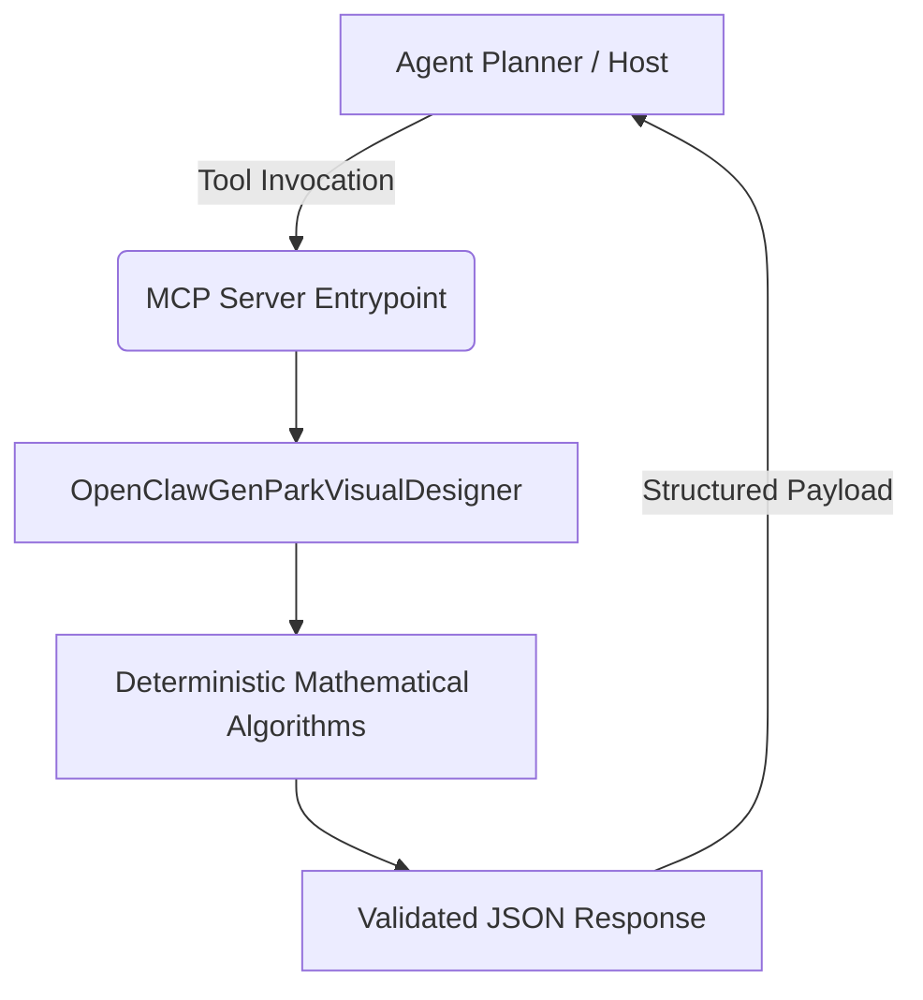

# openclaw-genpark-visual-designer

[](https://github.com/alphaparkinc/openclaw-genpark-visual-designer)
[](https://www.python.org/)
[](https://modelcontextprotocol.io/)
[](https://opensource.org/licenses/MIT)
[](https://github.com/Alpha-Park/openclaw-genpark-visual-designer)

Production-grade agentic skill designed for the OpenClaw and GenPark swarms. Built strictly using the Python standard library with zero external runtime dependencies.

## Architecture & Flow



## Features

- **Standard Library Only**: 100% Python standard library with no wheels, C-extensions, or pip requirements.
- **Model Context Protocol (MCP)**: Native FastMCP JSON-RPC interface for seamless tool-calling in Claude, Cursor, and OpenClaw.
- **Algorithmic Rigor**: Rigorous closed-form mathematical equations and quantitative deterministic metrics.
- **Multi-Tenant Mirrored**: Dual-deployed across `@alphaparkinc` and `@Alpha-Park`.

## Installation & Usage

```bash
git clone https://github.com/Alpha-Park/openclaw-genpark-visual-designer.git
cd openclaw-genpark-visual-designer
python example_usage.py
```

## MCP Configuration

Add to your `claude_desktop_config.json`:
```json
{
  "mcpServers": {
    "openclaw-genpark-visual-designer": {
      "command": "python",
      "args": ["-m", "openclaw-genpark-visual-designer.mcp_server"]
    }
  }
}
```

## License

MIT License. See [LICENSE](LICENSE) for details.
